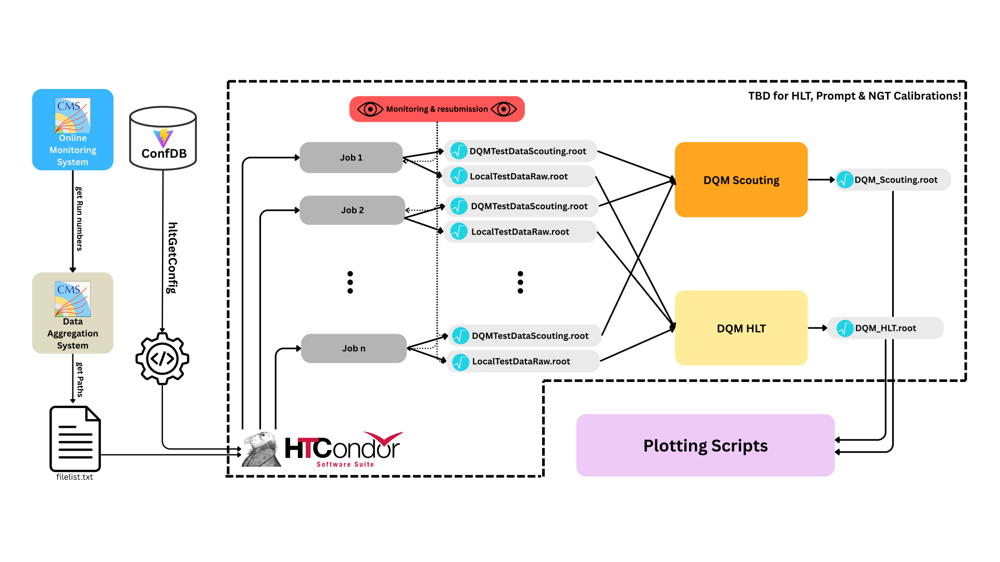

# NGT offline Evaluation Pipeline

This pipeline evaluates the performance of the NGT demonstrator: produce HLT
outputs for each calibration tag, check the batch jobs, run DQM, and compare the
harvested scouting histograms.



## Getting started

Run the production and DQM steps in a CMS environment with CMSSW, access to the
mounted EOS filesystem, and HTCondor for production jobs. The release used here
is **CMSSW_16_0_10**:

```bash
git clone git@github.com:cms-ngt-hlt/sakura.git
cd sakura/NERDAnalysis2026/AnalysisPipeline_ms/max_internship/
cmsrel CMSSW_16_0_10
cd CMSSW_16_0_10/src/
cmsenv
git cms-init
scram b -j 20
cd ../../
voms-proxy-init --voms cms -rfc --valid 168:00
cp "/tmp/x509up_u$(id -u)" .
```

Add packages via `git cms-addpkg` for custom changes (e.g. checking out private branches) before building.

Before running, edit [pipeline.cfg](pipeline.cfg). Its checked-in paths and dataset pattern are blank placeholders:

| Setting | What to configure |
| --- | --- |
| `CMSSW_SRC` | Absolute path to the CMSSW release's `src` directory, accessible to workers. Also used by the HLT DQM recipe to locate its source-client config. |
| `EOS_BASE` | Mounted EOS output directory for production; DQM reads `<EOS_BASE>/<tag>/run_<run>/`. |
| `EOS_XRD` | XRootD endpoint for production stage-out, matching your EOS location. |
| `DATASET_PATTERN` | Dataset regular expression for `generate_filelists.sh`; inspect the generated list before submission. Examples:<ul><li>`'^/EGamma[0-9]+/[^/]*ZElectron-PromptReco-v[0-9]+/RAW-RECO$'`</li><li>`'^/Muon[0-9]+/[^/]*ZMu-PromptReco-v[0-9]+/RAW-RECO$'`</li></ul> |
| `FILELIST` | Raw-data input list. Generate it or deliberately reuse an existing list. |
| `RUNS`, `TAGS`, `GTAGS` | Runs and calibration tags to process; `TAGS` and `GTAGS` are parallel arrays in the same order. |
| `DQM_DEST_BASE` | Destination for final DQM histograms. |
| `DQM_CONFIGS` | Enabled recipes; currently both `dqm/scouting.sh` and `dqm/hlt.sh`. Use only `dqm/scouting.sh` if you only need scouting. |
| `DQM_WORK_BASE`, `DQM_THREADS` | Attempt directories (default `DQM_work`) and scouting processing threads (default 24). |
| `DQM_BACKEND`, `DQM_SUBMIT` | `condor` (one HTCondor job per recipe/tag/run, the default) or `local` (sequential), and whether the generated jobs are submitted right away. |
| `DQM_JOBS_BASE`, `DQM_JOB_FLAVOUR`, `DQM_REQUEST_CPUS`, `DQM_REQUEST_MEMORY_MB`, `DQM_REQUEST_DISK_KB` | DQM job directories and per-job Condor resources. |
| `DQM_ARTIFACT_EXCLUDE` | Patterns left out of the artifacts a DQM job copies back; by default the ROOT files and `dqm.log`. |

Keep `PROXY` consistent with the copied proxy filename. Check that the selected
streams, menu, era, and batch resources suit your production. For NGT,
`oms_runs.csv` must contain a snapshot time for every input run.

Run the commands below from this pipeline directory unless stated otherwise.

## 1–2. Prepare and submit production jobs

### Combined preparation

```bash
./00_run_pipeline.sh
```

This regenerates `FILELIST` and `configs/hltDataDump.py` in parallel, then creates
jobs and submission files for every tag. It **does not submit** them. Review the
files and submit each tag, for example:

```bash
condor_submit condor_HLT.sub
condor_submit condor_Prompt.sub
condor_submit condor_NGT.sub
```

To prepare and submit in one invocation, use `./00_run_pipeline.sh --fulltrust`
instead. Both modes require the configuration above; automatic submission also
requires the proxy and `condor_submit` to be ready beforehand.

Existing `Jobs_<tag>` directories cause preparation to stop. `--force` deletes
and regenerates those directories, including local logs, but leaves EOS outputs
in place. Do not regenerate them while jobs or resubmissions still use them.

### Manual preparation

1. Activate CMSSW with `cmsenv` and generate the shared menu:

   ```bash
   ./01_make_config.sh
   ```

   This writes `configs/hltDataDump.py`.

2. Generate the input list (or check that the existing `FILELIST` is the intended
   one), then prepare and submit each tag:

   ```bash
   ./generate_filelists.sh
   python3 02_submit.py --tag HLT
   condor_submit condor_HLT.sub
   ```

   All tags (HLT, Prompt, and NGT) exclude runs absent from `oms_runs.csv`,
   keeping their run selections aligned. Job preparation prints a prominent
   warning and lists skipped runs again in its final summary. Only runs in the
   input file list are checked. If none remain, or `oms_runs.csv` is missing,
   preparation fails before replacing existing job directories, even with
   `--force`. The pipeline wrapper then stops before submission.

   Each tag has one `Jobs_<tag>/run_cfg.py`, frozen from the generated menu.
   Per-job scripts supply inputs and the NGT snapshot time through
   `HLT_JOB_OPTIONS`; workers copy the shared config to their temporary directory.
   The snapshot time is applied only to the records listed in `SNAPSHOT_RECORDS`
   in `pipeline.cfg` (per-record `GlobalTag.toGet` entries; the GT's tags are kept),
   or globally via `GlobalTag.snapshotTime` if that list is empty.
   Keep the job directories and shared configuration accessible and unchanged
   until jobs and resubmissions finish. Preparation with `02_submit.py` does not
   import CMSSW; menu generation and workers still require it.

## 3. Check production jobs

Monitor jobs with `condor_q`. Once they have finished, run this for each tag:

```bash
python3 03_check.py --tag NGT
```

It produces `check_report_NGT.md`, `resubmit_NGT.txt`, and
`condor_resubmit_NGT.sub`. Read the report and, if failures are listed, run:

```bash
condor_submit condor_resubmit_NGT.sub
```

Repeat after the resubmitted jobs finish. Reports made while jobs are active are
provisional. `PENDING` jobs are not automatically resubmitted; check whether they
are running or still need their original submission. Resolve missing outputs
before DQM: step 4 discovers files on disk and does not check the production
manifest for completeness.

## 4. Run DQM

To add a DQM workflow, place its Bash script in the `dqm/` folder and add its
path to `DQM_CONFIGS` in `pipeline.cfg` (for example, `"dqm/my_dqm.sh"`). Use
`dqm/scouting.sh` as a reference: the script receives its parameters from the
wrapper and must leave its final histogram output as `result.root` in its working
directory. See [DQM script instructions](dqm/README.md) for the available parameters.

With `EOS_BASE`, `DQM_DEST_BASE` and `CMSSW_SRC` configured and production
outputs available:

```bash
# All enabled recipes for one run and calibration tag:
./04_run_dqm.sh --tag NGT --run 403863

# All enabled recipes, tags, and runs:
./04_run_dqm.sh
```

The checked-in configuration enables **scouting and HLT**, in that order. Both
require CMSSW. Scouting runs multithreaded `cmsDriver.py` DQM and then harvesting;
HLT uses the existing source-client config under `CMSSW_SRC`.

Choose recipes in `DQM_CONFIGS` in `pipeline.cfg`; every listed recipe runs.
`--tag` and `--run` select configured entries; omitting a filter processes all
entries for that loop.

`DQM_BACKEND` in `pipeline.cfg` decides how the selected recipe/tag/run
combinations run:

- **`condor` (default):** one HTCondor job per combination, so all of them run
  in parallel, with the per-job resources from `pipeline.cfg`. The wrapper
  writes `DQM_JOBS_BASE/<recipe>/<tag>/run_<run>/` with the frozen recipe, the
  generated `job.sh` and the Condor logs, plus `dqm_jobs_to_run.txt` and
  `condor_dqm.sub`, and submits them unless `DQM_SUBMIT=false` or
  `--no-submit` is given. Each job sets up `CMSSW_SRC` itself, reads the mounted
  `EOS_BASE`, publishes its own histogram file, and copies its work directory
  back into `artifacts/` except for `DQM_ARTIFACT_EXCLUDE` (the ROOT files and
  `dqm.log`). Once `condor_q` is empty, collect the outcome with

  ```bash
  ./04_run_dqm.sh --status
  ```

  which writes `check_report_dqm.md`, `dqm_resubmit.txt` and
  `condor_dqm_resubmit.sub`; submit the latter to redo the flagged jobs.
  Regenerating over job directories that already hold output needs `--force`.

- **`local` (or `--local`):** the previous sequential behaviour, recipe → tag →
  run, stopping at the first failure. It needs `cmsenv` in the calling shell and
  keeps each attempt in `DQM_WORK_BASE/<recipe>/<tag>/run_<run>/attempt_*/`.

Both backends give the recipes the same environment and publish the same files,
so the choice only affects where and how many run at once. See the
[DQM README](dqm/README.md#batch-execution) for the job layout, the exit codes,
and the full list of statuses.

Final histograms are published as, for example:

```text
<DQM_DEST_BASE>/scouting/NGT/DQM_scouting_R000403863.root
<DQM_DEST_BASE>/hlt/NGT/DQM_hlt_R000403863.root
```

A successful rerun replaces that workflow/tag/run's published file; existing
results are not skipped. See [DQM instructions](dqm/README.md) for conditions,
input patterns, troubleshooting, and adding recipes.

## 5. Plot scouting results

Plotting reads the harvested DQM histograms, so run it only after step 4 has
published them under `DQM_DEST_BASE`.

### Plotting environment

The plotting scripts need Python with `numpy`, `uproot`, `pyyaml`, `matplotlib`
and `mplhep`, and the Z-to-ee fits also need PyROOT. The CMSSW release from
[Getting started](#getting-started) provides all of them, so on LXPLUS simply
run `cmsenv` before plotting:

```bash
cd CMSSW_16_0_10/src/
cmsenv
cd ../../plotting/
```

On a machine without CMSSW (e.g. a laptop), a virtual environment is enough
for the Scouting plots, but not for the Z-to-ee fits (no PyROOT). Create it in
a fresh shell without `cmsenv` so that CMS packages do not leak into it:

```bash
mkdir -p "$HOME/venvs"
python3 -m venv "$HOME/venvs/scouting-plots"
source "$HOME/venvs/scouting-plots/bin/activate"
python3 -m pip install --upgrade pip
python3 -m pip install numpy uproot pyyaml matplotlib mplhep
```

For each new terminal, activate the environment again with
`source "$HOME/venvs/scouting-plots/bin/activate"`. Both `which python` and
`python3 -m pip --version` should point inside that environment.

### Configure inputs

All plotting scripts read `DQM_DEST_BASE` from `pipeline.cfg` and resolve the
`conditions[].path` entries of [plotting/plotting_config.yaml](plotting/plotting_config.yaml)
(`Prompt`, `HLT`, `NGT`) under `<DQM_DEST_BASE>/scouting/` (Scouting plots) or
`<DQM_DEST_BASE>/hlt/` (Z-to-ee fits). Use `--local` to resolve them relative to
the working directory instead. Review the luminosity CSV, year, histogram prefix
in that YAML as well. Plots go to `PLOTS_DEST` in `pipeline.cfg` (default
`$DQM_DEST_BASE/plots`, e.g. set it to your CERNBox `www` area) or to
`--output-dir`; nothing is written to the working directory.

### Dedicated plots

Run the entry scripts from `plotting/`, because they load `plotting_config.yaml`
from the current working directory:

```bash
cd plotting
python3 invariantMass_ScoutingDielectron.py
python3 Z_to_ee_fit.py
python3 run_all_plots.py      # every plotting script in one go
```

The other plot entry scripts run the same way and share the options `--config`,
`--pipeline-cfg`, `--local`, `--output-dir` and `--lumi-csv`; `scouting_plot.py`
is the shared framework and `plotting_functions.py` holds the shared helpers.
All plots are written to `PLOTS_DEST` (or `--output-dir`). Each condition aggregates all `*.root` files in its directory,
so use matching run coverage across the compared tags.

### All 1D histograms

To compare *all* 1D histograms of the DQM files at once (instead of the
hand-picked ones of the dedicated scripts), use `all_1D_ScoutingDQM.py`; it
supports `--include`/`--exclude` regex filters and `--list`.

**On LXPLUS, using pipeline output:** set `DQM_DEST_BASE` in `pipeline.cfg`
to your DQM output base. With the default plotting config, inputs are
`$DQM_DEST_BASE/scouting/{Prompt,HLT,NGT}/*.root` (or directly under the base
when there is no `scouting/` directory). From this pipeline directory:

```bash
cd plotting
python3 all_1D_ScoutingDQM.py --limit 5 --jobs 1
python3 all_1D_ScoutingDQM.py --jobs 1 --no-png
```

Use `--jobs 1` on shared LXPLUS login nodes; the default uses all cores.

**Using local files:** put the ROOT files in `plotting/Prompt/`, `plotting/HLT/`
and `plotting/NGT/`, or set the condition paths in `plotting/plotting_config.yaml` to
their actual locations. From `plotting/`, run:

```bash
python3 all_1D_ScoutingDQM.py --local --output-dir /path/to/plots --limit 5 --jobs 1
python3 all_1D_ScoutingDQM.py --local --output-dir /path/to/plots --jobs 2 --no-png
```

`--local` skips reading or sourcing `pipeline.cfg` entirely, so the plot
destination must be given with `--output-dir`. Relative condition
paths are resolved from the working directory, absolute paths are used directly,
and `--pipeline-cfg` is ignored. This mode also works on LXPLUS. Omit `--no-png`
to write PNGs in addition to PDFs.

See the [all-1D plotting guide](plotting/README.md) for
environment troubleshooting, input layouts and the full list of options.

### Optional sanity check

`plotting/sanity_check_event_counter.py` shows the Z -> ee event counts for the
different calibration tags. It uses `plotting/plotting_config.yaml` and `DQM_DEST_BASE`
like the other Scouting plots (or `--local`); see the
[plotting README](plotting/README.md#event-count-sanity-check).

## Further information

See the [report](docs/report.pdf) for background on file-list curation and the
plotting architecture. For current DQM commands and output layout, use the
[DQM README](dqm/README.md).
